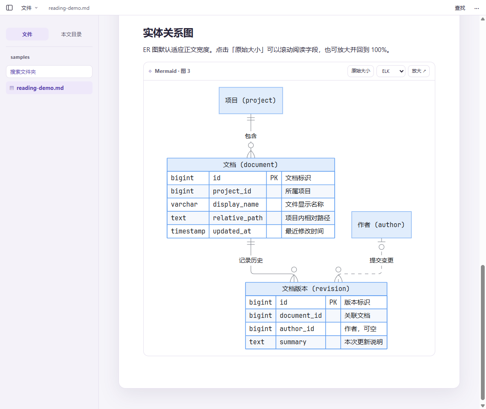

# 墨页 Moye · Windows Markdown Reader

Windows 本地 Markdown 阅读器。打开或拖入 Markdown 文件或文件夹，阅读带目录、表格、相对图片、Mermaid 和 PlantUML 图的文档。图表默认采用蓝色节点和细灰连线，Mermaid 流程图与 ER 图默认使用 ELK；可切到原始大小，或点击「放大」铺满应用窗口，再缩放、拖动和适应窗口，按 Esc 返回正文。主题和最近打开的文件/文件夹路径仅保存在本机，文档始终以只读方式打开。

**[下载 Windows x64 版](https://github.com/eval1007/moye-markdown/releases/latest)** · [反馈问题或建议](https://github.com/eval1007/moye-markdown/issues)

Moye is a local Markdown reader for Windows with WSL folder browsing, Mermaid and PlantUML diagrams, and text search.



## 使用

- Windows 10/11 x64，使用 WebView2 Runtime。
- 安装时可选择「只为我自己安装」（默认目录 `%LOCALAPPDATA%\Programs\Moye`）或「为本机所有用户安装」（默认目录 `%ProgramFiles%\Moye`，需要管理员权限）。两种模式都能修改目录。升级时默认沿用已安装的范围和目录；想切换范围，建议先卸载旧版并保留应用数据。
- 安装后可在文件管理器用「打开方式 → Moye」打开 Markdown。系统默认关联由用户选择。
- 左上角显示墨页 Logo，「文件」菜单提供打开文件、打开文件夹、WSL 路径和最近打开；也可用 Ctrl+O 或拖放。支持 UTF-8 的 `.md`、`.markdown`、`.mdown`。右上角外观图标按钮可直接选择「跟随系统」「浅色」「深色」。
- 顶部显示当前文档的相对路径，完整路径可悬停查看。点击侧栏图标或按 Ctrl+B 可以收起 / 展开文件树和目录。
- 文档默认显示预览；右上角「预览 / 原文」可随时切换。原文只读，保留 Markdown 标记，支持选中复制和 Ctrl+F 查找；打开新文档时回到预览，点击目录也会回到预览定位标题。
- 「打开文件夹」显示左侧文件树，点击 Markdown 文件后在右侧阅读。点「WSL 路径」可选择发行版并输入 Linux 绝对路径，也可粘贴 WSL 的 Windows 网络路径。输入时列出匹配的文件夹和 Markdown 文件；可点击或用方向键配合 Enter / Tab 补全，再点「打开」。
- 相对图片和 Markdown 链接以当前文档所在目录解析，允许读取已打开的根目录内的文件；没有打开根目录时限于当前文档目录。外部链接交给默认浏览器。预览不加载远程图片。
- `mermaid` 和 `plantuml` 代码块直接在正文绘图，随阅读界面切换浅色或深色。PlantUML 支持内置主题；依赖外部 `!include` 文件或未打包标准库的图需先展开依赖。
- 普通代码块使用 Shiki 的 GitHub 浅色/深色主题，提供语言标签和「复制」。内置 JavaScript/TypeScript（含 JSX/TSX）、JSON/JSONC、SQL、Shell、PowerShell、Python、Java、Go、Rust、HTML/CSS/XML、YAML/TOML、Dockerfile、Diff 和 Markdown 高亮；未标语言或不支持的语言保留原文显示。语法与主题随应用打包，阅读不依赖在线服务。
- 阅读时用 Ctrl+F 查找当前正文，Enter / Shift+Enter 跳到下一处 / 上一处。打开文件夹后用 Ctrl+P 模糊搜索文件名或相对路径（按相关度排序）、Ctrl+Shift+F 搜 Markdown 正文，也可从文件树点击「搜索文件夹」。打开结果会展开文件树中的对应路径；正文命中会跳到相应内容块并高亮可见文字。输入关键词后自动搜索；正文结果分批显示，修改关键词、切换搜索类型或关闭弹窗会取消旧查询。文件夹搜索在本地执行，最多显示前 100 条结果，跳过隐藏目录和 node_modules，不受 .gitignore 影响。正文按不区分大小写的原样关键词匹配，跳过超过 8 MiB 的文件。文件名路径缓存在内存并监听目录变化；每次打开搜索会重新确认文件列表，UNC/WSL 路径在搜索时最多复用 5 秒缓存。

## 开发与构建

用 Node.js 24 和 npm 安装锁定依赖。Windows 本机需要 Rust MSVC 工具链和 Visual Studio C++ Build Tools（见 [Tauri 构建环境](https://v2.tauri.app/start/prerequisites/)）。

```sh
npm ci
npm run tauri dev
npm run tauri build
```

`npm run dev` 也可单独检查阅读界面；浏览器模式不能读取用户所选 Markdown 的同目录图片，也没有 Windows 文件关联。用内置示例可验证图表和图片。Windows 安装包由 Tauri 生成，包含渲染依赖，无需在线图表服务或另装 Java。界面、正文、原文、代码块及图表统一使用随应用打包的 [JetBrains Mono v2.304](https://github.com/JetBrains/JetBrainsMono/releases/tag/v2.304)（[SIL OFL 1.1](public/licenses/JetBrainsMono-OFL.txt)），中文使用系统字体。图的显式样式、方向和分组仍由源文件定义。

源文件按职责分布在 `src/markdown.js`（解析）、`src/diagrams.js`（图表主题和 SVG）、`src/zoom.js`（大图）、`src/main.js`（阅读界面）和 `src-tauri/src/main.rs`（本地文件与启动请求）。

## 许可证

墨页自有代码使用 [MIT](LICENSE)。随应用分发的字体、布局引擎和其他依赖遵循[各自的许可证](THIRD_PARTY.md)。
