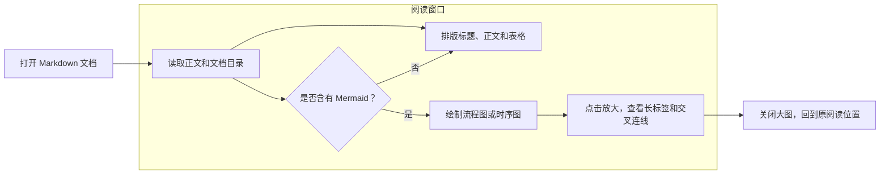
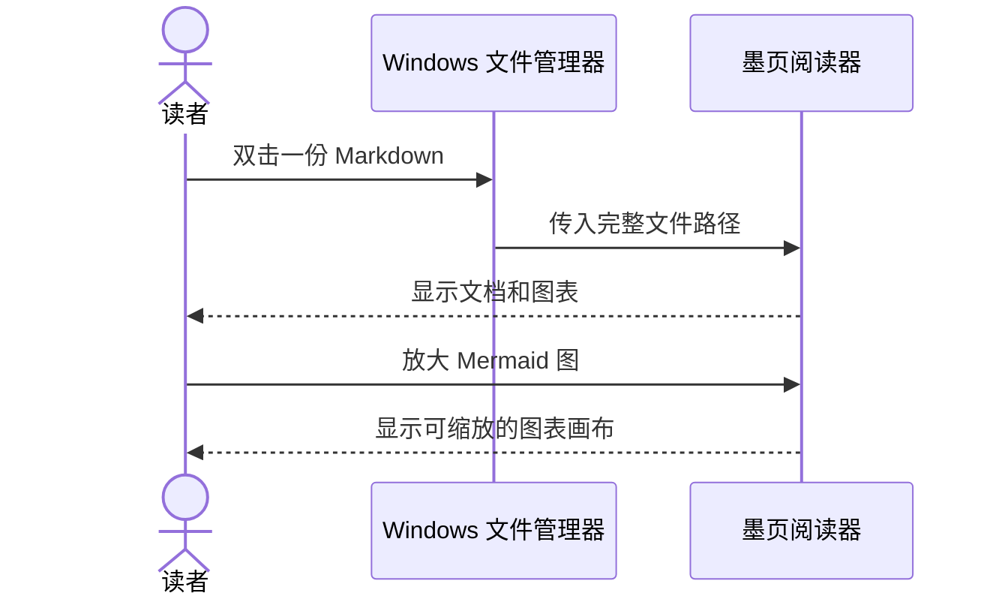

# Markdown 阅读示例

这是一份用来检查正文、中文图表和本地图片的示例。点击图表右上角的 **放大**，可以在阅读窗口里查看细节。

## 一次文件打开的流程



流程图可以按图切换 Dagre 和 ELK。图的源代码和 Markdown 文件不会因此变化。

## 双击打开已有文档



## 相对路径图片


## 排版检查

| 内容 | 阅读方式 |
| --- | --- |
| 标题 | 从左侧目录跳转 |
| 表格 | 宽表格可横向滚动 |
| 代码 | 保留换行，可选择和复制 |
| 图表 | 点击图或「放大」查看细节 |

> 第一版专注于阅读，打开文件不会改写它。

```text
Markdown 源码 → 排版 → 阅读
```

## 实体关系图

ER 图默认按原始大小显示，可横向或纵向滚动。点击「适应宽度」看全图，或在大图中按 100% 阅读字段。

~~~mermaid
erDiagram
    PROJECT["项目 (project)"]
    DOCUMENT["文档 (document)"]
    REVISION["文档版本 (revision)"]
    AUTHOR["作者 (author)"]
    PROJECT ||--o{ DOCUMENT : "包含"
    DOCUMENT ||--o{ REVISION : "记录历史"
    AUTHOR o|..o{ REVISION : "提交变更"

    DOCUMENT {
        bigint id PK "文档标识"
        bigint project_id "所属项目"
        varchar display_name "文件显示名称"
        text relative_path "项目内相对路径"
        timestamp updated_at "最近修改时间"
    }
    REVISION {
        bigint id PK "版本标识"
        bigint document_id "关联文档"
        bigint author_id "作者，可空"
        text summary "本次更新说明"
    }
~~~
